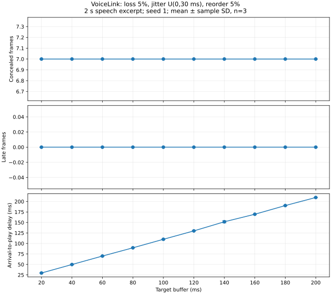

# VoiceLink 實作與量測報告

日期：2026-11-02。平台：Linux 雲端，GCC C11，loopback UDP。

## 驗收證據

- 官方測試 1–8：C→C 全過。PCM 225,082 bytes 完全相同（112,541 samples、352 frames），含非整框尾端。
- Python 參考 send→C recv、C send→Python 參考 recv：各 8/8 通過。
- 新增 13 個邊界測試：首包掉失、repeat/zero、seq 繞回、重複 BYE、壞包、SSRC、延遲 BYE、timeout、空檔與 WAV chunk 等。
- μ-law 無損包 SQNR 37.8 dB（門檻 30 dB），229,540 → 116,900 UDP payload bytes（含 BYE），比例 0.509。
- 隨機 5% loss：352 frames，lost=17、concealed=17，長度保持。
- ADPCM 選做加分未實作，測試 9 SKIP。
- devices 可以列舉，但只有 ALSA null 虛擬裝置。call 開預設麥克風失敗並回傳 1；實際通話未驗證，不列為通過。

原始終端輸出：`results/self-test.txt`、`ref-send.txt`、`ref-recv.txt`、`edges.txt`、`devices.txt`、`live-null.txt`。官方 codec 測試允許排除 concealed frames 計 SQNR；本次 clean codec concealed=0，沒有排除資料。

## 題目 1：buffer 多大？

固定官方中繼 `--loss .05 --jitter 30 --reorder .05 --seed 1`，buffer 從 20 到 200 ms，每點跑三次。使用教師語音前 2 秒（100 frames）；同 seed 重複測的是排程波動，不是三個獨立網路亂數樣本。中繼實作為 **uniform(0,30 ms)**，並非對稱 ±30 ms。完整原始資料與圖見 `results/buffer.csv` 和 `results/buffer.svg`。

| Buffer ms | concealed 平均 | late 平均 | arrival→play 平均 ms |
|---:|---:|---:|---:|
| 20 | 7.0 | 0.0 | 29.6 |
| 40 | 7.0 | 0.0 | 49.8 |
| 60 | 7.0 | 0.0 | 70.0 |
| 80 | 7.0 | 0.0 | 89.6 |
| 100 | 7.0 | 0.0 | 109.9 |
| 120 | 7.0 | 0.0 | 130.0 |
| 140 | 7.0 | 0.0 | 151.7 |
| 160 | 7.0 | 0.0 | 169.6 |
| 180 | 7.0 | 0.0 | 190.3 |
| 200 | 7.0 | 0.0 | 209.6 |

此固定種子和短片段下，20 ms 已無 late；增加 buffer 沒有再降低 concealed，因為七包是實際被中繼丟棄，等待也救不回來。**這組實測參數建議 20 ms**；一般示範仍保留規格預設 60 ms，為較差 Wi-Fi 留餘裕，但尚未用現場網路證明 60 ms 最佳。不能把此短片段推論成所有通話的最佳設定。較大的 buffer 幾乎線性增加到達至播放延遲。起始第一包的網路延遲會影響時鐘相位，因此平均值不一定正好等於設定值。

`--burst` 測得 received=352、overflow=340、concealed=340：預設只留 12 個 frame，最舊的遭丟棄，但播放仍照時鐘補滿 352 frames。最後留下的包平均等約 6.97 秒才輪到；顯示 pacing 不能省略，bounded queue 只保證 queue 記憶體不成長，不保證 burst 語音品質。

## 題目 2：repeat 與 zero 在 5% 掉包時的差別

使用完整 7.03 秒教師音檔、相同 seed=1、只有 loss=.05，每種設定丟 17 包。整檔 SQNR（包含 PLC 誤差，不排除補償 frame）：

| Codec | PLC | SQNR dB | concealed |
|---|---|---:|---:|
| pcm | zero | 19.29 | 17 |
| pcm | repeat | 14.64 | 17 |
| mulaw | zero | 19.23 | 17 |
| mulaw | repeat | 14.62 | 17 |

zero 把波形切到零，可能形成斷續與 click；repeat 延續上一個 frame，短缺口可能較平順，但不一定有相位連續性，連續重複 20 ms 片段會形成 50 Hz 週期及諧波，可能聽成嗡聲。實測這份資料 **zero 的 SQNR 反而較高**；repeat 並不保證波形誤差較小，SQNR 也不等於主觀可懂度。

以上聽感是訊號原理的預期，尚非真人聆聽結論。已提供 `results/loss5-{pcm,mulaw}-{zero,repeat}.wav` 四個檔案，組員需照 manual-test.md 實際聽完記錄偏好、片段及理由。

## Codec 與 live

PCM payload 位元率 256 kb/s，μ-law 128 kb/s；每秒 50 包，加入 12-byte 自訂 header 後分別為 260.8 / 132.8 kb/s（另有 IP/UDP overhead）。μ-law 的無損包 SQNR 通過門檻。5% loss 時整體誤差主要受 PLC 影響；壓縮後仍先解碼成 PCM 再補償。

Live 的程式路徑已建置，使用 miniaudio callback 和同一份 jitter buffer。雲端沒有可開啟的預設錄音裝置，已確認錯誤碼 1 路徑；B0 非 loopback 跨機與 A4 真實通話需現場補驗。端到端延遲包括 framing、網路、jitter buffer、裝置輸入輸出緩衝，尚未測得，不能把 STATS 的 avg_delay 當作端到端延遲。

## 重現與限制

`make test`、`make test-ref`、`make measure`。核心測試只需 Python 標準函式庫；量測圖需 matplotlib。Linux 已測，其他平台未實機確認。來源及允許沿用說明見 THIRD_PARTY.md。個人 C commit、真實分工、聆聽及跨機通話紀錄仍需組員完成。
